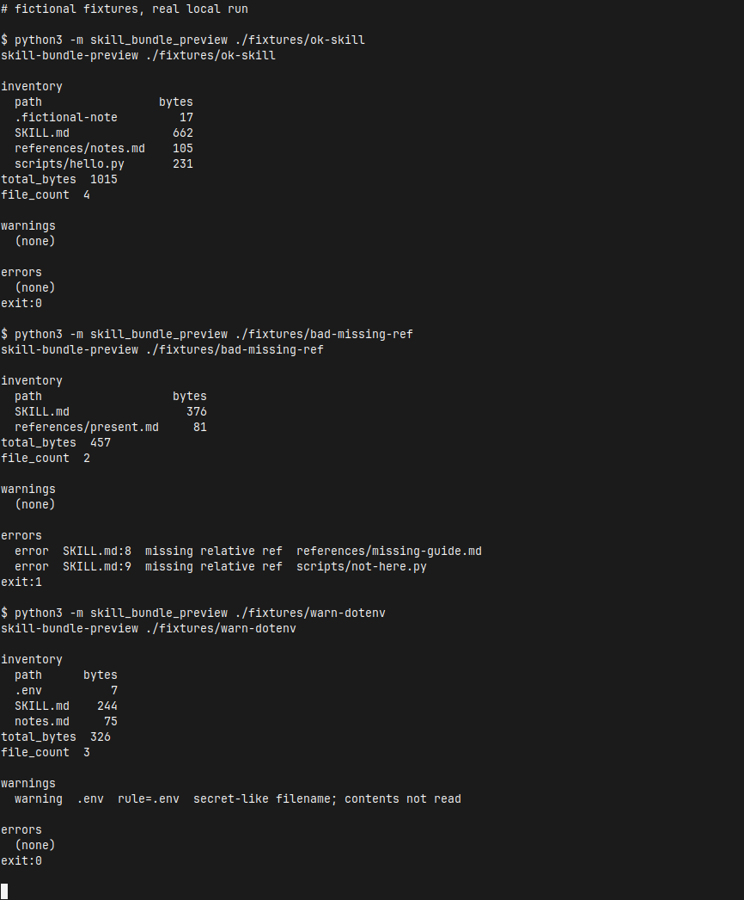

[English](README.md) | [简体中文](README.zh-CN.md) | [繁體中文](README.zh-TW.md) | [日本語](README.ja.md)

# skill-bundle-preview

Agent Skill のフォルダを共有したり zip にしたりする前に、手元でオフラインの予行をします。フォルダ内の各ファイルについて、相対パス、バイト数、合計を出します。basename が秘密らしい名前なら警告します。ルートの `SKILL.md` が指す相対パスがフォルダ内に無いときはエラーにします。

検査はヒューリスティックです。通過しても、マルウェア検査や秘密情報スキャンの証明にはなりません。拒否リストに合うファイルは開かず、内容も表示しません。アップロードはしません。通常の実行にネットワークは要りません。

コマンドの出力は英語です。同じ説明が [English](README.md)、[简体中文](README.zh-CN.md)、[繁體中文](README.zh-TW.md) にあります。

## 実行

クローンしたあと、インストールなしで次の 3 コマンドです。

```bash
git clone https://github.com/xuqijx/skill-bundle-preview.git
cd skill-bundle-preview
python3 -m skill_bundle_preview ./fixtures/ok-skill
```

Python 3 の標準ライブラリだけで動きます。このリポジトリは Python 3.12 で確認しています。クローンしたディレクトリで実行してください。そうしないと `skill_bundle_preview` を import できません。API キーは要りません。

ほかの手元での実行例です。

```bash
python3 -m skill_bundle_preview ./fixtures/bad-missing-ref
python3 -m skill_bundle_preview ./fixtures/warn-dotenv
python3 -m skill_bundle_preview ./fixtures/warn-dotenv --strict-secrets
python3 -m skill_bundle_preview --json ./fixtures/ok-skill
python3 check.py
```

## 終了コード

| 状態 | 意味 |
| --- | --- |
| 0 | エラーなし。警告はあってもよい。 |
| 1 | エラーが 1 件以上ある。 |
| 2 | 使い方または IO の問題。ルートの `SKILL.md` が無い場合と、それがシンボリックリンクである場合を含む。 |

## 出力

人が読む報告は 3 つの節です。

- **inventory**: 相対パスとバイト数、そのあと `total_bytes` と `file_count`。ドットファイルも残します。サイズは `lstat` です。ディレクトリのシンボリックリンクはたどりません。開くのはルートの `SKILL.md` だけです。
- **warnings**: 秘密らしい basename。行には一致した規則と `contents not read` が入ります。
- **errors**: ルートの `SKILL.md` にある欠けた相対参照（行番号つき）か、技能ディレクトリの外へ出る参照。`--strict-secrets` を付けると、秘密らしいファイル名はこちらに出ます。

`--json` は JSON を 1 つ出します。フィールドは `skill_dir`、`files`、`file_count`、`total_bytes`、`warnings`、`errors`、`strict_secrets` です。

## 秘密らしいファイル名（v0）

比べるのは basename だけです。大文字と小文字は区別します。最初に一致した規則を使います。ファイルは開きません。

| 規則 | basename の例 |
| --- | --- |
| `.env` | `.env` |
| `.env.*` | `.env.local` |
| `id_rsa*` | `id_rsa`、`id_rsa.pub` |
| `*.pem` | `server.pem` |
| `*.p12` | `client.p12` |
| `*.key` | `private.key` |
| `credentials.json` | `credentials.json` |
| `*.keystore` | `release.keystore` |

`--strict-secrets` はこれらの警告をエラーにします（終了コード 1）。普通の名前の中にある秘密はこの検査の外です。害のないファイルでも、これらの名前なら警告します。親ディレクトリの名前だけでは一致しません。

## 相対参照（v0）

開くのはルートの `SKILL.md` だけです。`notes.md` や `references/notes.md` を含むほかのファイルは、相対パスと `lstat` のバイト数として一覧に出るだけです。それらは開かず、ハッシュせず、参照の走査もしません。

ルートの `SKILL.md` から残すのは次です。

- インラインリンクと画像リンク
- `[notes]: references/notes.md` のような参照定義
- 相対パスに見えるバッククォート

バッククォートは、`./` か `../` で始まる、`/` を含む、または `.md`、`.py`、`.json`、`.png` のようなよくある拡張子の単一ファイル名であるときにパスとして扱います。拡張子の一覧は `skill_bundle_preview/refs.py` にあります。フェンスされたコードブロックは飛ばします。`http`、`https`、`mailto`、その他のスキーム、プロトコル相対 URL、フラグメントだけのリンクは飛ばし、取得もしません。

相対パスの対象が技能ディレクトリ内に無いとエラーです。`..` でディレクトリの外へ出る対象もエラーです。メッセージには `SKILL.md`、行番号、失敗したパスが入ります。

Markdown リンクでもバッククォートでもない地の文のパスは見ません。YAML frontmatter の検証はしません。

ルートの `SKILL.md` がシンボリックリンクなら拒否します（終了コード 2）。そのターゲットは開きません。ディレクトリのシンボリックリンクはたどりません。ファイルのシンボリックリンクは `lstat` のサイズで一覧し、開きません。秘密らしい basename も開きません。

## フィクスチャ

`fixtures/` のファイルはすべて架空です。実在の技能、製品、会社、人物ではなく、会社のデータも本物の資格情報も入っていません。

| パス | 手元での結果 |
| --- | --- |
| `fixtures/ok-skill/` | 終了コード 0。リンクとバッククォートのパスは解決する。フェンス内の例と `https://example.com/...` のリンクは無視する。 |
| `fixtures/bad-missing-ref/` | 終了コード 1。報告は `references/missing-guide.md` と `scripts/not-here.py` を指す。 |
| `fixtures/warn-dotenv/` | 終了コード 0。`.env` にあるのは偽の印 `FAKE=1` だけ。報告は警告し、その印は出さない。`--strict-secrets` では終了コード 1。 |

`fixtures/ok-skill/scripts/hello.py` は実行しません。

## デモ

下の画像は、このマシンの xfce4-terminal ウィンドウを撮ったものです。セッションでは 3 つのフィクスチャコマンドを実行しています。`$` で始まる行が実行したコマンドで、`exit:` がそのプロセスの終了状態です。トリミング後も端末ウィンドウが残っています。`.env` の本文は画面にありません。



## 出力例

このセッションの標準出力です。コマンド出力は英語です。

```text
# fictional fixtures, real local run

$ python3 -m skill_bundle_preview ./fixtures/ok-skill
skill-bundle-preview ./fixtures/ok-skill

inventory
  path                 bytes
  .fictional-note         17
  SKILL.md               662
  references/notes.md    105
  scripts/hello.py       231
total_bytes  1015
file_count  4

warnings
  (none)

errors
  (none)
exit:0

$ python3 -m skill_bundle_preview ./fixtures/bad-missing-ref
skill-bundle-preview ./fixtures/bad-missing-ref

inventory
  path                   bytes
  SKILL.md                 376
  references/present.md     81
total_bytes  457
file_count  2

warnings
  (none)

errors
  error  SKILL.md:8  missing relative ref  references/missing-guide.md
  error  SKILL.md:9  missing relative ref  scripts/not-here.py
exit:1

$ python3 -m skill_bundle_preview ./fixtures/warn-dotenv
skill-bundle-preview ./fixtures/warn-dotenv

inventory
  path      bytes
  .env          7
  SKILL.md    244
  notes.md     75
total_bytes  326
file_count  3

warnings
  warning  .env  rule=.env  secret-like filename; contents not read

errors
  (none)
exit:0
```

## チェック

`check.py` は 3 つのフィクスチャを実行し、終了コードを確かめます。報告に `.env` の内容が出ないこと、読めない `.env` でもファイル名の警告が出ること、パッケージがネットワーククライアントを import しないことも見ます。

```bash
python3 check.py
```

## 注意

- ファイル名の規則と Markdown の走査はヒューリスティックです。
- 通過は、フォルダにマルウェアや秘密が無いという証明ではありません。
- 拒否リストのファイルは開かず、内容も表示しません。
- ツールはフォルダをアップロードしません。通常の実行にネットワークは要りません。

## 対象外

- YAML frontmatter やスキーマの検証
- 技能スクリプトの実行
- フォルダのアップロードや公開
- ユーザーファイルの削除や変更
- フィクスチャへの会社名や本物の秘密の混入

## ライセンス

MIT。全文は [LICENSE](LICENSE) です。
