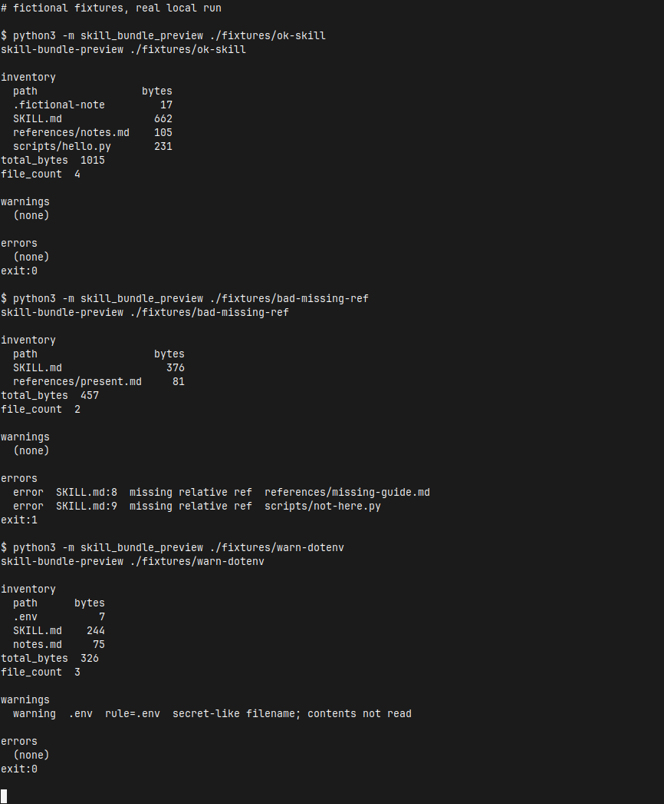

[English](README.md) | [简体中文](README.zh-CN.md) | [繁體中文](README.zh-TW.md) | [日本語](README.ja.md)

# skill-bundle-preview

Offline CLI dry-run before you share or zip an Agent Skill folder. It lists every file in the folder, with the relative path, the size in bytes, and a total. It warns when a basename looks secret-like. It errors when the root `SKILL.md` points at a relative path that is missing inside the folder.

The checks are heuristics. A clean run is not a malware scan and not a secret-scan certification. Files whose names match the denylist are not opened, and their contents are never printed. Nothing is uploaded. A normal run does not use the network.

Command output is English. The same instructions are in [简体中文](README.zh-CN.md), [繁體中文](README.zh-TW.md), and [日本語](README.ja.md).

## Run it

From a new clone, three commands and no install:

```bash
git clone https://github.com/xuqijx/skill-bundle-preview.git
cd skill-bundle-preview
python3 -m skill_bundle_preview ./fixtures/ok-skill
```

Python 3 and the standard library are enough. This repository was exercised with Python 3.12. Run the module from the clone so Python can import `skill_bundle_preview`. There is no API key.

Other local runs:

```bash
python3 -m skill_bundle_preview ./fixtures/bad-missing-ref
python3 -m skill_bundle_preview ./fixtures/warn-dotenv
python3 -m skill_bundle_preview ./fixtures/warn-dotenv --strict-secrets
python3 -m skill_bundle_preview --json ./fixtures/ok-skill
python3 check.py
```

## Exit status

| Status | Meaning |
| --- | --- |
| 0 | No errors. Warnings are allowed. |
| 1 | One or more errors. |
| 2 | Usage or IO problem, including a missing root `SKILL.md` or a root `SKILL.md` that is a symlink. |

## What it prints

Human output has three sections.

- **inventory** lists each relative path and its size in bytes, then `total_bytes` and `file_count`. Dotfiles stay in the list. Sizes come from `lstat`. Directory symlinks are not followed. Only the root `SKILL.md` is opened.
- **warnings** name secret-like basenames. Each line includes the matched rule and the words `contents not read`.
- **errors** name a missing relative ref from the root `SKILL.md`, with the line, or a ref that escapes the skill directory. With `--strict-secrets`, secret-like filenames are reported in this section instead.

`--json` prints one JSON object with `skill_dir`, `files`, `file_count`, `total_bytes`, `warnings`, `errors`, and `strict_secrets`.

## Secret-like filenames (v0)

Matching uses the basename only. It is case-sensitive. The first matching rule wins. The file is not opened.

| Rule | Basename examples |
| --- | --- |
| `.env` | `.env` |
| `.env.*` | `.env.local` |
| `id_rsa*` | `id_rsa`, `id_rsa.pub` |
| `*.pem` | `server.pem` |
| `*.p12` | `client.p12` |
| `*.key` | `private.key` |
| `credentials.json` | `credentials.json` |
| `*.keystore` | `release.keystore` |

`--strict-secrets` turns these warnings into errors (exit 1). A secret stored under an ordinary name is outside this check. A harmless file that uses one of these names still warns. A secret-like parent directory is not itself a match.

## Relative refs (v0)

Only the root `SKILL.md` is opened. Other files, including other markdown such as `notes.md` and `references/notes.md`, are inventory rows: a relative path and an `lstat` size. They are not opened, hashed, or scanned for refs.

From the root `SKILL.md` the checker keeps:

- inline links and image links
- reference definitions such as `[notes]: references/notes.md`
- backtick spans that look like a relative path

A backtick span counts when it starts with `./` or `../`, contains `/`, or is a single filename with a common extension such as `.md`, `.py`, `.json`, or `.png`. The extension list lives in `skill_bundle_preview/refs.py`. Fenced code blocks are skipped. `http`, `https`, `mailto`, other schemes, protocol-relative URLs, and fragment-only links are skipped. They are not fetched.

A relative target that is missing inside the skill directory is an error. A target that would leave the directory through `..` is an error. The message includes `SKILL.md`, the line number, and the path that failed.

Paths written as ordinary prose, with no markdown link and no backticks, are left alone. YAML frontmatter is not validated.

A root `SKILL.md` that is a symlink is rejected (exit 2) and its target is not opened. Directory symlinks are not followed. File symlinks are listed with their `lstat` size and are not opened. Secret-like basenames are not opened either.

## Fixtures

Every file under `fixtures/` is fictional. These folders are not real skills, products, companies, or people. They contain no company data and no real credentials.

| Path | Local result |
| --- | --- |
| `fixtures/ok-skill/` | Exit 0. Links and backtick paths resolve. A fenced example and an `https://example.com/...` link are ignored. |
| `fixtures/bad-missing-ref/` | Exit 1. The report names `references/missing-guide.md` and `scripts/not-here.py`. |
| `fixtures/warn-dotenv/` | Exit 0. `.env` contains only the fake marker `FAKE=1`. The report warns and does not print that marker. `--strict-secrets` exits 1. |

`fixtures/ok-skill/scripts/hello.py` is not executed.

## Demo

The image is a capture of a local xfce4-terminal window. The session ran the three fixture commands. Each `$` line is the command that was run, and `exit:` is the process status printed after it. The crop keeps the terminal window. The body of `.env` is not on screen.



## Sample output

This is the stdout from that session.

```text
# fictional fixtures, real local run

$ python3 -m skill_bundle_preview ./fixtures/ok-skill
skill-bundle-preview ./fixtures/ok-skill

inventory
  path                 bytes
  .fictional-note         17
  SKILL.md               662
  references/notes.md    105
  scripts/hello.py       231
total_bytes  1015
file_count  4

warnings
  (none)

errors
  (none)
exit:0

$ python3 -m skill_bundle_preview ./fixtures/bad-missing-ref
skill-bundle-preview ./fixtures/bad-missing-ref

inventory
  path                   bytes
  SKILL.md                 376
  references/present.md     81
total_bytes  457
file_count  2

warnings
  (none)

errors
  error  SKILL.md:8  missing relative ref  references/missing-guide.md
  error  SKILL.md:9  missing relative ref  scripts/not-here.py
exit:1

$ python3 -m skill_bundle_preview ./fixtures/warn-dotenv
skill-bundle-preview ./fixtures/warn-dotenv

inventory
  path      bytes
  .env          7
  SKILL.md    244
  notes.md     75
total_bytes  326
file_count  3

warnings
  warning  .env  rule=.env  secret-like filename; contents not read

errors
  (none)
exit:0
```

## Check

`check.py` runs the three fixtures and asserts those exit codes. It also checks that `.env` contents stay out of the report, that an unreadable `.env` still produces a filename warning, and that the package does not import a network client.

```bash
python3 check.py
```

## Disclaimers

- Filename rules and the markdown scan are heuristics.
- A passing run is not a certification that the folder is free of malware or secrets.
- Denylist files are not opened, and their contents are never printed.
- The tool does not upload the folder. A normal run does not use the network.

## Non-goals

- YAML frontmatter or schema validation
- Executing skill scripts
- Uploading or publishing the folder
- Deleting or modifying user files
- Company names or real secrets in the fixtures

## License

MIT. The full text is [LICENSE](LICENSE).
