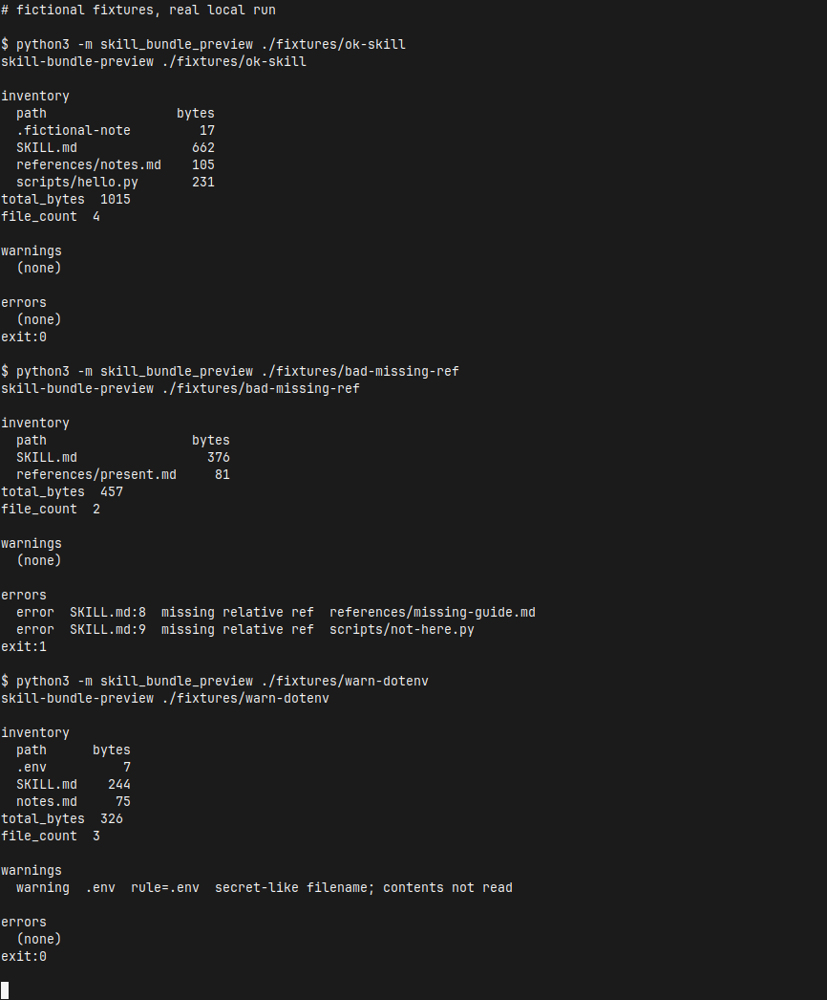

[English](README.md) | [简体中文](README.zh-CN.md) | [繁體中文](README.zh-TW.md) | [日本語](README.ja.md)

# skill-bundle-preview

在分享或打包 Agent Skill 文件夹之前，先在本地做一次离线预检。它列出文件夹里的每个文件、相对路径、字节大小和合计；按文件名（basename）警告看起来像密钥的名字；如果根目录 `SKILL.md` 里的相对路径在文件夹内不存在，则报错。

这些检查都是启发式规则。通过预检并不表示完成了恶意软件扫描，也不构成密钥扫描认证。命中排除名单的文件不会被打开，内容也不会被打印。工具不会上传文件夹。正常运行不使用网络。

命令输出是英文。同一份说明还有 [English](README.md)、[繁體中文](README.zh-TW.md) 和 [日本語](README.ja.md)。

## 运行

克隆之后，三条命令，不需要安装：

```bash
git clone https://github.com/xuqijx/skill-bundle-preview.git
cd skill-bundle-preview
python3 -m skill_bundle_preview ./fixtures/ok-skill
```

需要 Python 3 标准库。本仓库在 Python 3.12 上跑过。请在克隆下来的目录里运行，这样 Python 才能导入 `skill_bundle_preview`。不需要 API key。

其他本地命令：

```bash
python3 -m skill_bundle_preview ./fixtures/bad-missing-ref
python3 -m skill_bundle_preview ./fixtures/warn-dotenv
python3 -m skill_bundle_preview ./fixtures/warn-dotenv --strict-secrets
python3 -m skill_bundle_preview --json ./fixtures/ok-skill
python3 check.py
```

## 退出码

| 状态 | 含义 |
| --- | --- |
| 0 | 没有错误。可以有警告。 |
| 1 | 有一个或多个错误。 |
| 2 | 用法或 IO 问题，包括根目录没有 `SKILL.md`，或根目录 `SKILL.md` 是符号链接。 |

## 输出

人类可读的报告有三节。

- **inventory**：每个相对路径和字节大小，然后是 `total_bytes` 与 `file_count`。点文件会保留在清单里。大小来自 `lstat`。目录符号链接不会被跟进去。只会打开根目录的 `SKILL.md`。
- **warnings**：秘密式文件名。每一行包含命中的规则，以及 `contents not read`。
- **errors**：根目录 `SKILL.md` 里缺失的相对引用（带行号），或逃出技能目录的引用。加上 `--strict-secrets` 后，秘密式文件名改在这一节报出。

`--json` 打印一个 JSON 对象，字段有 `skill_dir`、`files`、`file_count`、`total_bytes`、`warnings`、`errors`、`strict_secrets`。

## 秘密式文件名（v0）

只匹配 basename，区分大小写。第一条命中的规则生效。文件不会被打开。

| 规则 | basename 例子 |
| --- | --- |
| `.env` | `.env` |
| `.env.*` | `.env.local` |
| `id_rsa*` | `id_rsa`、`id_rsa.pub` |
| `*.pem` | `server.pem` |
| `*.p12` | `client.p12` |
| `*.key` | `private.key` |
| `credentials.json` | `credentials.json` |
| `*.keystore` | `release.keystore` |

`--strict-secrets` 把这些警告变成错误（退出码 1）。普通文件名里的秘密不在这次检查范围内。无害文件如果用了这些名字，仍会警告。父目录名字本身不会触发规则。

## 相对引用（v0）

只会打开根目录的 `SKILL.md`。其他文件，包括 `notes.md`、`references/notes.md` 这类 Markdown，只作为清单里的相对路径和 `lstat` 字节数。它们不会被打开、哈希或扫描引用。

从根目录 `SKILL.md` 里会保留这些写法：

- 行内链接和图片链接
- 引用式定义，例如 `[notes]: references/notes.md`
- 看起来像相对路径的反引号片段

反引号片段在这些情况下算路径：以 `./` 或 `../` 开头、包含 `/`，或是带常见扩展名的单个文件名（例如 `.md`、`.py`、`.json`、`.png`）。完整扩展名列表在 `skill_bundle_preview/refs.py`。围栏代码块会跳过。`http`、`https`、`mailto`、其他 scheme、协议相对 URL，以及只有片段标识的链接会跳过，也不会去获取。

相对目标在技能目录内不存在，就是错误。用 `..` 离开技能目录，也是错误。消息里包含 `SKILL.md`、行号和失败的路径。

没有写成 Markdown 链接或反引号的普通文字路径不会检查。不校验 YAML frontmatter。

根目录 `SKILL.md` 如果是符号链接，会拒绝并退出码 2，且不会打开它的目标。目录符号链接不会跟随。文件符号链接按 `lstat` 大小列入清单，不会被打开。秘密式 basename 也不会被打开。

## 示例夹具

`fixtures/` 下的每个文件都是虚构的。这些文件夹不是真实技能、产品、公司或人物，也不含公司数据或真实凭证。

| 路径 | 本地结果 |
| --- | --- |
| `fixtures/ok-skill/` | 退出码 0。链接和反引号路径都能对上。围栏里的例子和 `https://example.com/...` 链接会被忽略。 |
| `fixtures/bad-missing-ref/` | 退出码 1。报告会点出 `references/missing-guide.md` 和 `scripts/not-here.py`。 |
| `fixtures/warn-dotenv/` | 退出码 0。`.env` 里只有假标记 `FAKE=1`。报告给出警告，且不会打印该标记。`--strict-secrets` 的退出码是 1。 |

`fixtures/ok-skill/scripts/hello.py` 不会被执行。

## 演示

下面这张图是本机 xfce4-terminal 窗口的截图。这次会话运行了上面三个夹具命令。以 `$` 开头的行是实际执行的命令，`exit:` 是该进程的退出状态。裁剪后保留终端窗口。画面上没有 `.env` 的正文。



## 示例输出

下面是该会话的标准输出。命令输出为英文。

```text
# fictional fixtures, real local run

$ python3 -m skill_bundle_preview ./fixtures/ok-skill
skill-bundle-preview ./fixtures/ok-skill

inventory
  path                 bytes
  .fictional-note         17
  SKILL.md               662
  references/notes.md    105
  scripts/hello.py       231
total_bytes  1015
file_count  4

warnings
  (none)

errors
  (none)
exit:0

$ python3 -m skill_bundle_preview ./fixtures/bad-missing-ref
skill-bundle-preview ./fixtures/bad-missing-ref

inventory
  path                   bytes
  SKILL.md                 376
  references/present.md     81
total_bytes  457
file_count  2

warnings
  (none)

errors
  error  SKILL.md:8  missing relative ref  references/missing-guide.md
  error  SKILL.md:9  missing relative ref  scripts/not-here.py
exit:1

$ python3 -m skill_bundle_preview ./fixtures/warn-dotenv
skill-bundle-preview ./fixtures/warn-dotenv

inventory
  path      bytes
  .env          7
  SKILL.md    244
  notes.md     75
total_bytes  326
file_count  3

warnings
  warning  .env  rule=.env  secret-like filename; contents not read

errors
  (none)
exit:0
```

## 自检

`check.py` 会运行三个夹具并核对退出码。它还会确认报告里没有 `.env` 的内容、不可读的 `.env` 仍然按文件名警告，以及程序包没有导入网络客户端。

```bash
python3 check.py
```

## 声明

- 文件名规则和 Markdown 扫描都是启发式的。
- 通过预检并不是“文件夹不含恶意软件或秘密”的认证。
- 排除名单上的文件不会被打开，内容也不会被打印。
- 工具不会上传文件夹。正常运行不使用网络。

## 非目标

- 不校验 YAML frontmatter 或 schema
- 不执行技能脚本
- 不上传、不发布文件夹
- 不删除、不修改用户文件
- 夹具里不放公司名称或真实秘密

## 许可证

MIT。全文见 [LICENSE](LICENSE)。
