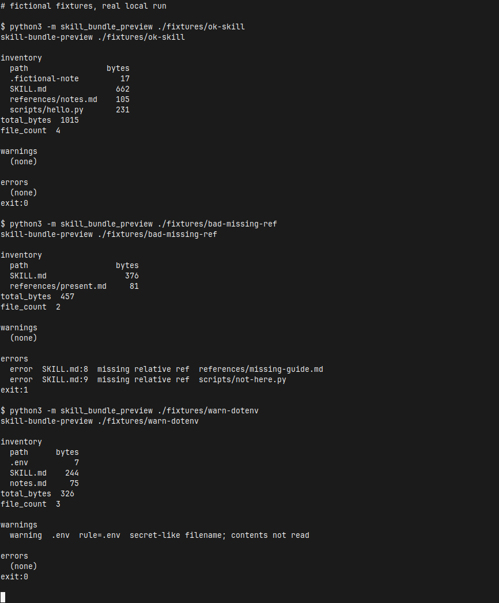

[English](README.md) | [简体中文](README.zh-CN.md) | [繁體中文](README.zh-TW.md) | [日本語](README.ja.md)

# skill-bundle-preview

在分享或打包 Agent Skill 資料夾之前，先在本機做一次離線預檢。它列出資料夾裡的每個檔案、相對路徑、位元組大小與合計；依檔名（basename）警告看起來像密鑰的名字；如果根目錄 `SKILL.md` 裡的相對路徑在資料夾內不存在，就報錯。

這些檢查都是啟發式規則。通過預檢並不表示完成了惡意軟體掃描，也不構成密鑰掃描認證。命中排除名單的檔案不會被開啟，內容也不會被印出。工具不會上傳資料夾。正常執行不使用網路。

命令輸出是英文。同一份說明還有 [English](README.md)、[简体中文](README.zh-CN.md) 和 [日本語](README.ja.md)。

## 執行

複製之後，三道命令，不需要安裝：

```bash
git clone https://github.com/xuqijx/skill-bundle-preview.git
cd skill-bundle-preview
python3 -m skill_bundle_preview ./fixtures/ok-skill
```

需要 Python 3 標準庫。這個儲存庫在 Python 3.12 上跑過。請在複製下來的目錄裡執行，Python 才能匯入 `skill_bundle_preview`。不需要 API key。

其他本機命令：

```bash
python3 -m skill_bundle_preview ./fixtures/bad-missing-ref
python3 -m skill_bundle_preview ./fixtures/warn-dotenv
python3 -m skill_bundle_preview ./fixtures/warn-dotenv --strict-secrets
python3 -m skill_bundle_preview --json ./fixtures/ok-skill
python3 check.py
```

## 結束狀態

| 狀態 | 意義 |
| --- | --- |
| 0 | 沒有錯誤。可以有警告。 |
| 1 | 有一個或多個錯誤。 |
| 2 | 用法或 IO 問題，包括根目錄沒有 `SKILL.md`，或根目錄 `SKILL.md` 是符號連結。 |

## 輸出

給人讀的報告有三節。

- **inventory**：每個相對路徑和位元組大小，接著是 `total_bytes` 與 `file_count`。點檔會留在清單裡。大小來自 `lstat`。目錄符號連結不會被跟著走下去。只會開啟根目錄的 `SKILL.md`。
- **warnings**：秘密式檔名。每一行列出命中的規則，以及 `contents not read`。
- **errors**：根目錄 `SKILL.md` 裡缺少的相對參照（含行號），或逃出技能目錄的參照。加上 `--strict-secrets` 後，秘密式檔名改在這一節報出。

`--json` 印出一個 JSON 物件，欄位有 `skill_dir`、`files`、`file_count`、`total_bytes`、`warnings`、`errors`、`strict_secrets`。

## 秘密式檔名（v0）

只比對 basename，區分大小寫。第一條命中的規則生效。檔案不會被開啟。

| 規則 | basename 例子 |
| --- | --- |
| `.env` | `.env` |
| `.env.*` | `.env.local` |
| `id_rsa*` | `id_rsa`、`id_rsa.pub` |
| `*.pem` | `server.pem` |
| `*.p12` | `client.p12` |
| `*.key` | `private.key` |
| `credentials.json` | `credentials.json` |
| `*.keystore` | `release.keystore` |

`--strict-secrets` 把這些警告變成錯誤（結束狀態 1）。普通檔名裡的秘密不在這次檢查範圍。無害檔案如果用了這些名字，仍會警告。父目錄名稱本身不會觸發規則。

## 相對參照（v0）

只會開啟根目錄的 `SKILL.md`。其他檔案，包括 `notes.md`、`references/notes.md` 這類 Markdown，只作為清單裡的相對路徑和 `lstat` 位元組數。它們不會被開啟、雜湊或掃描參照。

從根目錄 `SKILL.md` 裡會保留這些寫法：

- 行內連結與圖片連結
- 參照式定義，例如 `[notes]: references/notes.md`
- 看起來像相對路徑的反引號片段

反引號片段在這些情況下算路徑：以 `./` 或 `../` 開頭、包含 `/`，或是帶常見副檔名的單檔名（例如 `.md`、`.py`、`.json`、`.png`）。完整副檔名清單在 `skill_bundle_preview/refs.py`。圍欄程式碼區塊會跳過。`http`、`https`、`mailto`、其他 scheme、協定相對 URL，以及只有片段識別的連結會跳過，也不會去抓取。

相對目標在技能目錄內不存在，就是錯誤。用 `..` 離開技能目錄，也是錯誤。訊息裡包含 `SKILL.md`、行號和失敗的路徑。

沒有寫成 Markdown 連結或反引號的普通文字路徑不會檢查。不驗證 YAML frontmatter。

根目錄 `SKILL.md` 如果是符號連結，會拒絕並以結束狀態 2 退出，且不會開啟它的目標。目錄符號連結不會跟隨。檔案符號連結按 `lstat` 大小列入清單，不會被開啟。秘密式 basename 也不會被開啟。

## 範例夾具

`fixtures/` 下的每個檔案都是虛構的。這些資料夾不是真實技能、產品、公司或人物，也不含公司資料或真實憑證。

| 路徑 | 本機結果 |
| --- | --- |
| `fixtures/ok-skill/` | 結束狀態 0。連結和反引號路徑都能對上。圍欄裡的例子和 `https://example.com/...` 連結會被忽略。 |
| `fixtures/bad-missing-ref/` | 結束狀態 1。報告會指出 `references/missing-guide.md` 和 `scripts/not-here.py`。 |
| `fixtures/warn-dotenv/` | 結束狀態 0。`.env` 裡只有假標記 `FAKE=1`。報告給出警告，且不會印出該標記。`--strict-secrets` 的結束狀態是 1。 |

`fixtures/ok-skill/scripts/hello.py` 不會被執行。

## 示範

下面這張圖是本機 xfce4-terminal 視窗的擷圖。這次工作階段執行了上面三個夾具命令。以 `$` 開頭的行是實際執行的命令，`exit:` 是該行程的結束狀態。裁切後保留終端機視窗。畫面上沒有 `.env` 的本文。



## 範例輸出

下面是該工作階段的標準輸出。命令輸出為英文。

```text
# fictional fixtures, real local run

$ python3 -m skill_bundle_preview ./fixtures/ok-skill
skill-bundle-preview ./fixtures/ok-skill

inventory
  path                 bytes
  .fictional-note         17
  SKILL.md               662
  references/notes.md    105
  scripts/hello.py       231
total_bytes  1015
file_count  4

warnings
  (none)

errors
  (none)
exit:0

$ python3 -m skill_bundle_preview ./fixtures/bad-missing-ref
skill-bundle-preview ./fixtures/bad-missing-ref

inventory
  path                   bytes
  SKILL.md                 376
  references/present.md     81
total_bytes  457
file_count  2

warnings
  (none)

errors
  error  SKILL.md:8  missing relative ref  references/missing-guide.md
  error  SKILL.md:9  missing relative ref  scripts/not-here.py
exit:1

$ python3 -m skill_bundle_preview ./fixtures/warn-dotenv
skill-bundle-preview ./fixtures/warn-dotenv

inventory
  path      bytes
  .env          7
  SKILL.md    244
  notes.md     75
total_bytes  326
file_count  3

warnings
  warning  .env  rule=.env  secret-like filename; contents not read

errors
  (none)
exit:0
```

## 自檢

`check.py` 會執行三個夾具並核對結束狀態。它也會確認報告裡沒有 `.env` 的內容、不可讀的 `.env` 仍然依檔名警告，以及套件沒有匯入網路客戶端。

```bash
python3 check.py
```

## 聲明

- 檔名規則和 Markdown 掃描都是啟發式的。
- 通過預檢並不是「資料夾不含惡意軟體或秘密」的認證。
- 排除名單上的檔案不會被開啟，內容也不會被印出。
- 工具不會上傳資料夾。正常執行不使用網路。

## 非目標

- 不驗證 YAML frontmatter 或 schema
- 不執行技能腳本
- 不上傳、不發布資料夾
- 不刪除、不修改使用者檔案
- 夾具裡不放公司名稱或真實秘密

## 授權

MIT。全文見 [LICENSE](LICENSE)。
